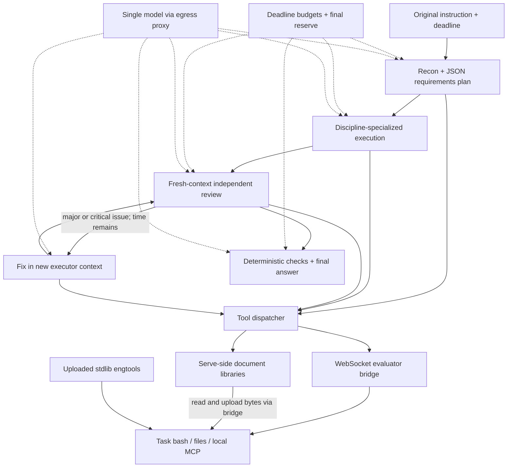

# PLE Agent Harness

A deadline-aware engineering agent for [Physical-Engineering’s Last Exam
(PLE)](https://github.com/google-research/ple): 85 structural, civil, electrical
and mechanical engineering tasks, including 29 public dev tasks and 56 hidden
test tasks. PLE asks for project deliverables, graded by programmatic checks,
expert-rubric model judging, or both—not just plausible chat answers.

This Apache-2.0 entry derives its model loop and protocol bridge from Google
Research’s reference implementation; see [NOTICE](NOTICE). The competition model
is `google-cloud/claude-opus-5-5`. No official dev score has been measured yet.
This is an independent entry, not an official Google product.

## Architecture



Each phase uses a reusable `AgentLoop` with its own prompt, tools, conversation
and absolute monotonic deadline. Planning atomizes requirements. Execution writes
deliverables early. Independent review reopens outputs and recomputes important
numbers. At most two fix/review rounds run by default. Finalization checks planned
files are nonempty, inspects office files, and summarizes paths and assumptions.
Exceptions are handled best-effort with executor-summary fallbacks; plan and
timing/token trace are saved under `/tmp/ple_work/`.

The reference loop’s streaming, retry/backoff, Claude caching and thinking-block
preservation, Responses fallback, token-limit fallback, truncated-output
continuation, context compaction and deadline-aware finishing are retained.
MCP connects once per task and is shared across sequential phases.

### Tool layer and engtools

* **Task-side:** bash, read/write/edit files, and available local MCP tools.
  Task containers have no network and may lack document libraries.
* **Serve-side:** `extract_text`, `write_docx`, `write_xlsx`, `inspect_office` use
  python-docx, openpyxl and pypdf; bytes move through the evaluator protocol.
  Reads enforce 10,000,000 bytes; uploads use 5,000,000-byte append chunks.
  Extraction supports PDF, DOCX, XLSX/XLSM, PPTX and text formats; spreadsheet
  extraction caps at 1000 rows/sheet, and expanded ZIP inputs at 100 MB.
* **Stdlib engineering library:** uploaded to `/tmp/ple_work/engtools/`, with
  units, structural, electrical, mechanical, civil, economics and Markdown
  calculation-log modules. Use `PYTHONPATH=/tmp/ple_work python3 script.py`.
  Python 3.8+ compatible, with formula sources, units and assumptions in docstrings.

These are idealized helpers, not complete code-compliance checks. Conductor tables
are caller-supplied. Spreadsheet formulas are preserved but **not evaluated**;
cached values may be missing until a spreadsheet engine recalculates the file.
Read-only phases omit write tools and prohibit mutating bash/MCP by prompt.
Reviewer bash starts in `/tmp/ple_work`. **This is not an OS-level write sandbox.**

### Configuration

Frozen `Config` in `ple_harness/config.py` accepts these overrides. Shares apply
to then-remaining work time after the final reserve, not the original total.
The earliest task deadline/limit applies. Invalid environment settings are logged
and fall back to defaults. In kit runs, put nonsecret overrides in
`submission.yaml`'s `env`: arbitrary host `PLE_*` variables are not forwarded.

| Variable | Default | Meaning |
| --- | ---: | --- |
| `PLE_DEFAULT_TOTAL_SECONDS` | 3600 | Fallback total without a task limit |
| `PLE_RECON_SHARE` | 0.12 | Planning share; maximum 0.12 |
| `PLE_EXECUTE_SHARE` | 0.55 | Initial execution share |
| `PLE_VERIFY_SHARE` | 0.15 | Each review share; maximum 0.15 |
| `PLE_FIX_SHARE` | 0.65 | Each fix round share |
| `PLE_MIN_PHASE_SECONDS` | 120 | Skip undersized work phases; tiny-budget fallback applies |
| `PLE_FINAL_RESERVE_SECONDS` | 90 | Fixed final reserve floor |
| `PLE_FINAL_RESERVE_SHARE` | 0.03 | Reserve is max(floor, total × share), bounded by available time |
| `PLE_FINALIZE_SECONDS` | 90 | Final-answer loop cap |
| `PLE_FINAL_CHECK_SECONDS` | 30 | Deterministic-check cap |
| `PLE_SETUP_SECONDS` | 60 | Setup cap |
| `PLE_MAX_FIX_ROUNDS` | 2 | Maximum fix/review rounds |

### Layout and reuse

```text
submission.yaml, serve.py, harness.py, taskbridge.py  Entry, solver and protocol server
ple_harness/
  llm.py, common.py                     Reusable model loop and message helpers
  orchestrator.py, config.py            Phases and budgets
  tools.py, host_tools.py               Registry and host document tools
  mcp.py, install.py, engtools/          MCP and uploaded engineering package
tests/                                 Offline unit tests and local HTTP tests
examples/synthetic_task/                Original integration fixture
scripts/                               Mock server and offline/dev runners
results/                               Synthetic results, not official artifacts
WRITEUP.md                             Competition writeup draft
```

`AgentLoop(session, system_prompt, initial_messages, tools, dispatch,
deadline=None, role="agent", client=None)` returns `(final_text, history)` from
`await loop.run()`. Caller owns client cleanup. Register custom tools with
`ToolDispatcher.register(spec, async_handler)`; connect one `MCPCatalog` per task.

## Setup & resources

Use a local [Docker daemon](https://docs.docker.com/engine/install/), Git,
[uv](https://docs.astral.sh/uv/) and Harbor. Keep this repo separate from PLE:

```bash
curl -LsSf https://astral.sh/uv/install.sh | sh
export PATH="$HOME/.local/bin:$PATH"
uv tool install harbor==0.20.0 --with websockets
# Only if PLE is not already checked out:
git clone https://github.com/google-research/ple.git "$HOME/repos/ple"
```

Read upstream [kit](https://github.com/google-research/ple/blob/main/kit/README.md),
[evaluation](https://github.com/google-research/ple/blob/main/eval/README.md),
[model](https://github.com/google-research/ple/blob/main/docs/models.md) and
[fair-play](https://github.com/google-research/ple/blob/main/docs/rules.md) docs.
For real tasks, request gated access and accept the terms on the
[Hugging Face dataset](https://huggingface.co/datasets/google/physical-engineerings-last-exam),
then provide an account read token as `HF_TOKEN`. Never commit tokens, `.env`
files, raw private logs or task datasets.

**Hardware used:** Linux host with about 31 GiB RAM, 124 GB root filesystem
(about 108 GB free at documentation time), Docker 29.9.2. This is not a measured
full-dev-set requirement. Upstream asks for about 10 GB free for base images plus
task/world images; world images are about 17 GB. Docker Desktop needs at least
6 CPUs and 16.25 GB RAM for the largest task plus serve stack. Start with one
trial; concurrency increases resources. Tasks can take six hours each, plus
setup and grading, and real model calls incur charges.

Competition entries use one sponsored `google-cloud/<id>` model. Local runs need
a proxy backed by your own billed Google Cloud project. Own-provider keys and
`openai-compatible/<model>` are supported locally but are not valid competition
submissions. The synthetic mock requires neither paid access nor a dataset token.

## How to run

### Unit tests

```bash
cd ~/repos/ple-agent-harness
uv run --with-requirements requirements.txt --with pytest pytest -q
uv run ruff check .
/usr/bin/python3 -I -S tests/test_engtools.py
```

### Offline end-to-end

```bash
cd ~/repos/ple-agent-harness
scripts/run_offline_e2e.sh "$HOME/ple-offline-runs/example"
```

Output directory must be new; override `PLE_ROOT` for another PLE checkout.
Initial image/dependency provisioning needs network: this is not an air-gapped
cold build. The episode runs real Docker, a no-network task, the kit protocol
relay and Harbor verifier. A stdlib mock listens on `0.0.0.0:8090` (trusted dev
hosts only). A local entry copy uses `openai-compatible/fake` and
`--model-base-url http://localhost:8090/v1`; the kit rewrites localhost to
`host.docker.internal` and grants that exact egress-proxy endpoint exception.

The runner uses `kit check --no-smoke`, then Harbor's kit `ServeAgent` directly:
`eval/run.py --tasks-dir` still selects official dev IDs, not our synthetic task.
Unrelated smoke/MCP checks are skipped. It asserts reward 1.0, no exception,
collected DOCX/JSON, phase completion and final message. Logs remain in the output
directory. This tests integration, **not reasoning or competition readiness**.

### Free local CPU model

```bash
cd ~/repos/ple-agent-harness
scripts/start_local_model.sh
scripts/run_local_model.sh check --output "$HOME/ple-offline-runs/qwen-check-example"
# Requires access to the gated dev dataset, even though inference is free:
scripts/run_local_model.sh eval --output "$HOME/ple-offline-runs/qwen-eval-example"
```

The starter downloads the public Qwen/Qwen3-8B-GGUF Q4_K_M model without a token,
verifies its SHA-256, and uses a digest-pinned llama.cpp Docker image. It runs
Qwen3-8B with a 32768-token context, Jinja tool templates, eight CPU threads,
one slot and alias `qwen3-8b`. It leaves an existing running `llama` container
alone. Allow model loading to finish (`curl http://localhost:8091/health`).
The unauthenticated server binds `0.0.0.0:8091` so Docker can reach it: use a
trusted host/network, not a public-facing machine. CPU generation is slow.

The wrapper creates a new copy outside the checkout, excluding secrets and
artifacts, and declares `openai-compatible/qwen3-8b` **only in that copy**.
The main `submission.yaml` remains unchanged. The kit runs from `~/repos/ple`
(`PLE_ROOT` overrides this), with `--model-base-url http://localhost:8091/v1`
and a dummy key. `check` includes `--cancel-test`; `eval` defaults to one trial
at a time and uses the same local server for judging unless `JUDGE_BASE_URL`
and `JUDGE_API_KEY` configure another judge (`JUDGE_MODEL` selects its model).
Extra kit/eval flags are forwarded; `--base-url` selects another local endpoint.
The CPU profile defaults to `REASONING_EFFORT=none` to avoid spending short task
budgets on hidden reasoning before any tool runs. Use `--reasoning-effort high`
to enable it; this affects only the local copy, not the competition entry.
Logs and any eval-generated artifacts stay under the printed copy/run paths.
These local-only entries are not submissions; review and regenerate genuine
dev artifacts with the intended competition model before submitting anything.

### Real model, kit checks and dev evaluation

After obtaining your own project/model and gated dataset access:

```bash
cd ~/repos/ple
gcloud auth application-default login
export VERTEXAI_PROJECT='<your-gcp-project>'
export MODEL_PROXY_KEY="$(openssl rand -hex 24)"
kit/model_proxy/start.sh &
export MODEL_PROXY_URL=http://localhost:4000
export HF_TOKEN='<your-HF-read-token>'
# Load actual secrets securely; do not commit them or enable shell tracing.

uv run python -m kit validate ~/repos/ple-agent-harness
uv run python -m kit build ~/repos/ple-agent-harness
uv run python -m kit check ~/repos/ple-agent-harness

# Judge uses MODEL_PROXY_URL/KEY when no explicit judge endpoint is set:
export JUDGE_MODEL=claude-opus-5-5
mkdir -p "$HOME/ple-dev-runs"
uv run python eval/run.py ~/repos/ple-agent-harness --trials 1 \
  --out "$HOME/ple-dev-runs/first"
```

Use a new or empty `--out`. The proxy must be reachable from Docker (default bind:
`0.0.0.0`, not loopback-only). Without an explicit judge endpoint, do not set
`JUDGE_API_KEY`. For a separate judge set both `JUDGE_BASE_URL` and `JUDGE_API_KEY`,
and a `JUDGE_MODEL` it serves. Precedence: explicit judge, model proxy, own-model
fallback for local-only entries. If pointing only `JUDGE_BASE_URL` at the kit proxy
without `MODEL_PROXY_URL`, use `JUDGE_MODEL=claude-opus-5-5-judge`. The evaluator’s
Opus 5 refusal fallback is judge behavior, not a second harness model.

Equivalent environment-only wrapper (same proxy/HF environment):

```bash
cd ~/repos/ple-agent-harness
scripts/run_dev_eval.sh "$HOME/ple-dev-runs/wrapped"
# Optional subset, exported by the official evaluator:
DEV_TASKS=data-center-site-model,engineers-estimate-check \
  scripts/run_dev_eval.sh "$HOME/ple-dev-runs/subset"
```

`DEV_TRIALS` defaults to 1; `PLE_ROOT` changes the kit checkout. The wrapper reads
credentials only from inherited environment, never creates secret files or prints
their values, and does not expose `--no-export`. The kit manages private transient
runtime environment files itself. Review raw logs before publishing. Real dev
evaluation has **not** been run here.

`eval/run.py` exports to this entry's `./artifacts/` by default, also saving
`results.json`, `export.json` and run artifacts under `--out`. A subset updates
only its task folders. To import a saved run, validate, or regrade:

```bash
cd ~/repos/ple
uv run python -m kit artifacts ~/repos/ple-agent-harness --from "$HOME/ple-dev-runs/first"
uv run python -m kit artifacts ~/repos/ple-agent-harness
uv run python eval/run.py --artifacts ~/repos/ple-agent-harness
# Recover failed judge grading without rerunning the harness:
uv run python eval/run.py --regrade "$HOME/ple-dev-runs/first"
```

Never hand-edit exported artifacts/manifests. Limits include 95 MiB per deliverable,
256 MiB/2000 files per task, and 512 MiB/10000 files total.

## Results

| Recorded check | Result |
| --- | --- |
| Synthetic Docker/Harbor episode | 1 trial, 0 exceptions, reward 1.0 |
| Synthetic current | 133.646 A; DOCX and JSON content checks passed |
| Unit suite | 62 passed in 1.83 s |
| Ruff | All checks passed |
| Official kit, local Qwen3-8B Q4_K_M on CPU, reasoning `none` | Smoke 19 s; MCP 35 s; cancel passed |
| Local reasoning ablation: `high` | Smoke 287 s; MCP did not write its file within budget |
| Local reasoning ablation: `none` | Smoke, MCP and cancel passed; not a dev-set score |
| Organizers' submission-template baseline: Pi + Claude Opus 5.5 | Mean dev reward **0.491** across 29 manifest tasks; **not our score** |

| Official kit stage (local Qwen, reasoning `none`) | Result |
| --- | --- |
| submission.yaml | PASS |
| files | WARN: disposable entry copy is not a Git repository |
| build | PASS: 121 MiB bundle, 27 s |
| model | PASS: 12.4 s through egress proxy |
| listen | PASS: 2 s |
| smoke | PASS: 19 s |
| MCP | PASS: 35 s |
| cancel | PASS: done within 10 s of cancellation |
| artifacts | WARN: genuine dev artifacts not generated |

**Our own dev-set score is unmeasured because the Hugging Face dataset is gated.**
Local self-hosted inference is available, but this check is not a dev evaluation
or a submission-readiness claim. The required root `harness.py` now exports the
solver used by `serve.py`; keep it alongside `submission.yaml` and `serve.py`.

See [recorded results](results/README.md) and [writeup draft](WRITEUP.md). The mock
has fixture-specific scripts; production `solve()` does not call it. Our official
dev/test scores and model costs remain unmeasured. The reference mean is computed
from the organizers' committed `artifacts/manifest.json`, not from our harness.
DOCX content and structure were
checked, but visual rendering remains unverified.

## How to submit

1. Review current rules and competition announcements. Run the real dev set using
   the exact harness and declared sponsored model intended for submission.
2. Review changes for secrets/task content. Commit harness and official exported
   `artifacts/` together, staging explicit reviewed paths, including deletions.
   Manifest digests bind artifacts to harness files; rerun after relevant changes.
3. After committing, from `~/repos/ple` run `uv run python -m kit check
   ~/repos/ple-agent-harness`. Require **`ready to submit`**, not just exit code 0
   or a partial/no-smoke pass.
4. Push the reviewed commit to your GitHub repo when ready. An entry is a single
   commit containing harness, YAML and dev artifacts. Follow
   [ple-bench.com](https://ple-bench.com) for submission mechanics/dates; upstream
   says these will be announced. This repository has not been submitted.

## Limitations and license

Same-model review can repeat execution errors. Budgets/formulas need real-task
calibration. No web search or external APIs are part of the harness; runtime
egress is restricted to the model. Engineering outputs require qualified review.
Code is [Apache-2.0](LICENSE), with attribution preserved in [NOTICE](NOTICE).
